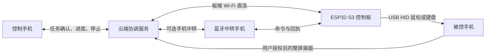

# 超级手机控制器

用 **Flutter 手机助手、ESP32-S3 控制板和云端协调服务**，让一台手机下发任务，另一台手机在你授权后共享画面并接受 USB 键鼠操作。控制板负责执行，服务使用新的真实画面核验结果。

**安装 Android 正式版：** [官方下载页](https://d.zhangyue.site/apps/phone-controller-flash/) · [安装、配对与故障排查](docs/android-getting-started.md)

截至 **2026-11-18**，官方主包已核对为 **1.4.10（83）**，包名 `site.zhangyue.pcflash`。本分支是基于该版源码的 **Material 3 界面候选**，不是已发布的 APK；不会改变控制协议、固件、后端、安装身份或现行分发入口。

## 两台手机怎么配合

| 角色 | 做什么 | 需要共享本机屏幕？ |
| --- | --- | --- |
| 控制手机 | 绑定目标、输入任务、核对范围、确认执行、查看结果或停止 | 不需要 |
| 被控手机 | 连接控制板、按系统提示共享整屏、提供绑定码 | 需要本人授权 |
| ESP32-S3 控制板 | 通过 USB HID 执行鼠标或键盘动作，返回回执 | 不采集画面 |
| 云端协调服务 | 接收授权画面、调度动作并核验结果 | 只接收被控端授权上传的画面 |

USB 连接、共享有效、云端在线、操作许可和结果核验是不同状态。蓝牙已连接不代表云端在线，板端收到动作也不代表任务成功。日常控制不用 ADB 做截图、点击或输入兜底。

## 快速开始

1. 被控手机用支持数据的 USB / OTG 连接控制板；按 Android 系统提示开始整屏共享。
2. 按现场条件使用控制板 Wi-Fi 直连，或选择已有的手机蓝牙中转路径。
3. 在被控端打开「连接控制手机」，在控制端输入页面显示的绑定码。不要公开绑定码；以界面显示的有效期和管理方式为准。
4. 输入低风险任务，例如「打开设置」；先点「查看并确认任务」，核对目标及范围后再确认执行。
5. 随时使用底部停止按钮。若停止未确认，按提示使用控制板的停止按钮；不要把等待回执视为已停止，也不要重发结果未知的动作。

更多细节见[控制流程](docs/control-flow.md)与[界面说明](docs/android-ui.md)。

## 发布与验收

| 对象 | 边界 |
| --- | --- |
| Android 正式包 | 从官方下载页获取；覆盖更新须匹配现有包名及签名。旧包名需找对应兼容包，不要卸载原 App 换包。 |
| Material 3 界面候选 | 包含首页、任务、被控连接、设置的视觉调整；不代表已经部署或完成真机验收。 |
| 固件与 iOS | 分开构建与验收；Android 界面改版不证明固件升级或 iOS 同等能力可用。 |
| 任务结果 | 单步回执、独立画面核验、完整双机任务、连续任务和异常恢复需分别记录。 |

## 开发入口

| 目录 | 用途 |
| --- | --- |
| `app/` | Flutter 界面、Android / iOS 原生桥接、Widget 和集成测试 |
| `display_service/` | 画面、任务、指令与回执处理 |
| `firmware-amoled/`、`firmware-epaper/` | 分板型固件 |
| `tools/`、`tests/` | 公共源码检查、构建辅助和回归测试 |
| `.github/workflows/` | 手机 App 与固件云构建 |

先读 [AGENTS.md](AGENTS.md)、[文档索引](docs/README.md) 与 [App 配置与测试](docs/app-configuration.md)。在独立分支工作；不要依据 `main` 上的历史版本号判断正式 APK。原始 APK、签名材料、设备身份、部署地址及未经脱敏的截图不提交到仓库。

仓库可公开查看，但尚未设置项目开源许可证；第三方依赖与素材遵循各自许可。
