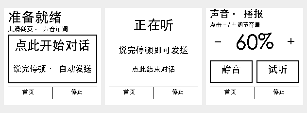

# 超级手机控制器

目标：手机不安装应用、不启用安卓无障碍服务，使用系统投屏获取画面，通过 ESP32-S3 USB HID 控制手机；日常使用脱离 Mac。优先验证小米 17 Ultra、小米 9、Civi 3，并适配 iPhone。

## 当前实际状态

- `firmware/`：原型按钮、麦克风初始化和灯效；尚未实现采音和 HID。
- `coordinator/sessions.py`：多设备独立绑定、画面新鲜度检查、指令过期与一次性消费；8 项单元测试通过。它不提供网络认证、图像采集或实际控制。
- `host/phone_wifi.py`：历史 Mac 配网辅助，不属于最终运行链路。密码从环境变量或钥匙串读取。
- `reference/`：不完整的历史参考，依赖原环境，不可直接部署。

尚未完成投屏接收、HID、语音识别、视觉决策和多机实测。没有声称任何手机已兼容。

## 无应用方案的待定硬件

手机不装采集应用时，候选为独立 Linux 接收盒：安卓 Miracast，iPhone AirPlay。每部受控手机连接一块独立 USB HID 板；采集源与板子必须显式配对。用户已明确拒绝独立接收盒；该方案不再作为实施目标。

Miracast 多路并发受网卡、驱动和 Wi-Fi Direct 组合限制；必须先验证单路，再评估多网卡或独立接收通道。不能假定单网卡支持多部。iPhone 鼠标需开启系统 AssistiveTouch；屏幕共享需用户启动。受保护画面可能无法采集。

当前 AtomS3U 无 PSRAM，不承担完整无线投屏接收或本地视觉模型。新调研发现 ESP32-S3 上接收 AirPlay H.264 压缩流的参考实现，但它要求 PSRAM 和手机 App。应研究无 App 的转发/解码方案，不可据此宣布现有无 PSRAM 板子已可用。

## 验证

在仓库目录执行：

```sh
python3 -m unittest discover -s tests -v
```

## 参考

- https://github.com/espressif/esp-idf/tree/master/examples/peripherals/usb/device/tusb_hid
- https://github.com/FDH2/UxPlay
- https://github.com/albfan/miraclecast
- https://github.com/Genymobile/scrcpy

仅列为调研参考，尚未合入其代码。引入时保留并遵守各自许可证。

## 新增调研：插入式接收

https://github.com/onehumanbeing/esp32-iphone-agent

已阅读其 AirPlay mirror.c 与 video_link.cpp：板端处理 H.264 码流而不解码，经 BLE 发回手机 App；视频 GOP 缓冲 4 MiB，另有 512 KiB scratch，均分配 PSRAM。该项目不是免 App 方案，也未证明支持小米 Miracast。下一步需核实：压缩流直接上传联网服务的可行性、网络上行、当前板子的流式内存预算；安卓 Miracast 接入另行研究。没有合入第三方代码。

## 2026-10-20 墨水屏新增进度

- 新增 `firmware-epaper/`：独立的微雪200×200固件，已编译、备份原板整片Flash后刷写校验通过；USB设备随后换为另一块，板端启动与显示尚待原板重新接入验证。
- 新增 `display_service/`：已在106部署，额度与交互由服务器生成；经过HTTPS验证，匿名401、设备鉴权200、位图5000字节。
- MiMo当时登录有效；扩展现有自动续期策略，覆盖HTTP403及业务401/403，不将网络错误误判为登录过期。
- 自动手机操作、投屏与语音尚未接通。现固件是额度与交互展示基础，不代表整个手机控制器已完成。

## 2026-10-21 1.54 英寸交互与声音优化

- 实体键为主要操作入口：A短按翻页、双击首页、按住说话；B短按首页、双击静音并进入声音页、长按停止。声音页A加/B减。主页只显示大状态和说话提示。
- 所有页面保留首页/停止快捷，但不依赖触屏小区域。停止不等待墨水屏刷新，并要求全部按键松开后才能再次开始。板载PWR超长按3秒关闭电池保持；外接B不会关机。
- ES8311 增加离线中文状态播报；声音页按20%调节板子扬声器音量、切换静音和试听，设置保存到NVS。静音不影响麦克风。尚未接入任意AI回答的TTS朗读。
- Flutter 升级 App 修复扫描/页面生命周期、连接状态、通知竞态及中断；板端修复蓝牙UUID、服务广播和升级写入顺序。
- 升级在最终启动槽提交前可以中断；开始切换启动槽后无法撤销，会继续重启。
- 主机测试：`python3 tools/test_host.py` 与 `python3 -m unittest discover -s tests -v`。App：`cd app && flutter test`、`dart analyze lib test`。
- 当前为软件验证阶段；真实墨水屏刷新、扬声器响度、麦克风和BLE连续升级需目标板实测。没有据此新增手机兼容性声明。

参考：Eta 的任务状态、停止与结果核验思路；当前没有合入 Eta 代码，也未改变为必须安装无障碍 App 的方案。

可选外接两个常开干接点：GPIO1—按键A—GND，GPIO2—按键B—GND。默认关闭外接输入，外接版增加 `sdkconfig.external-keys.defaults`。具体映射与接线见 [验证与接线记录](docs/handoff/2026-10-21-interaction-audio-validation.md)。



### 屏幕与连续语音输入

1.54 英寸屏幕点击开始，连接准备完成后自动收音；说完停顿后提交识别，提示后继续听。语音页中部大区域结束对话，首页及翻页也结束收音。10 秒无声或最多 12 轮后退出，声音页支持音量、静音和试听。当前为连续 ASR 提示，尚无聊天回答/手机执行器，不支持常驻唤醒词。

### 106 对话与本地 ADB 链路

新增聊天上下文、真实结果语音及大字结果页；手机任务由板端本地ADB逐步执行并回读验证，屏幕停止同时取消对话、播放和执行队列。106不使用旧offline中继作为执行证据。云端真实聊天/ASR/TTS及模拟手机步骤测试已通过，实际USB手机执行仍待目标板和小米在线验收。详情见 [验证记录](docs/handoff/2026-10-21-dialogue-adb-validation.md)。
