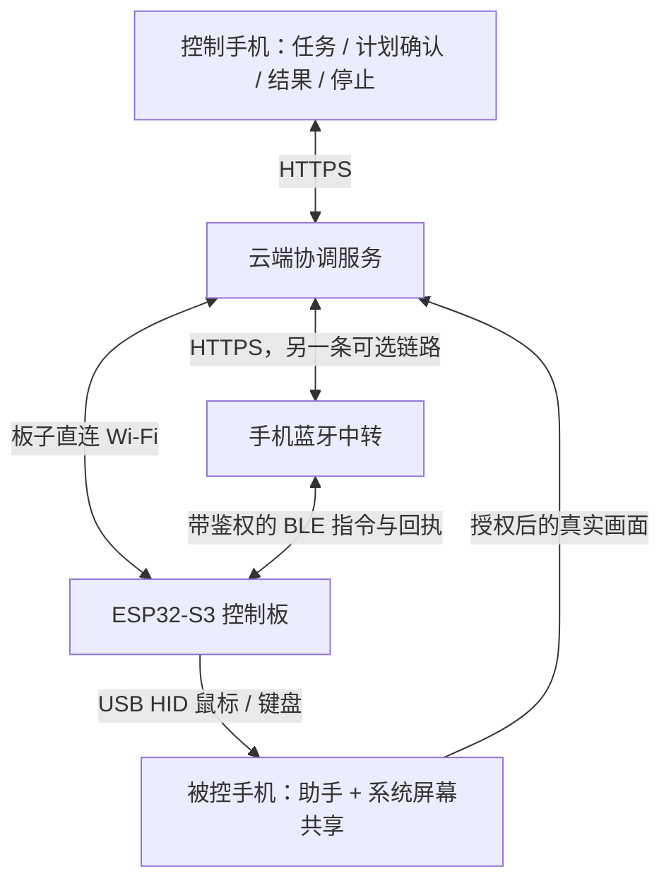

# 超级手机控制器

通过 **Flutter 手机助手 + ESP32-S3 USB HID + 云端协调服务**，让一台手机下发任务，另一台手机提供画面并接受键鼠操作。控制板负责执行，云端根据真实画面规划和核验结果。

> **进度快照：2026-10-29，持续实机联调中。** 已用真实控制板完成 Pixel 3 的“打开设置”，并通过动作后的新画面独立核验。连续任务中仍发现连接中断，中文搜索闭环与稳定性验收尚未完成；当前不承诺所有手机兼容。

**公开开发分支：[`public/text-cloud-relay-20261026`](https://github.com/zhangyue-site/super-phone-controller/tree/public/text-cloud-relay-20261026)。** 默认 `main` 保留早期基线，不能仅凭默认分支的版本号判断实机进度。实机联调代码与公开分支仍有同步差异；文中的验收记录不代表所有改动已同步、可直接复现或正式发布。

## 两台手机怎么配合

| 角色 | 负责什么 | 是否需要共享本机屏幕 |
| --- | --- | --- |
| 控制手机 | 输入任务、查看计划、确认执行、查看结果、停止操作 | **不需要** |
| 被控手机 | 安装助手、连接控制板、授权共享画面 | **需要系统授权** |
| ESP32-S3 控制板 | 通过 USB 模拟鼠标和键盘，返回实际执行回执 | 不采集手机画面 |
| 云端协调服务 | 理解画面、定位目标、派发动作、核验结果 | 接收被控手机授权上传的画面 |

蓝牙中转可由具备相应能力的手机承担，同一块板子同一时间只保留一个执行连接。控制手机通过蓝牙承担中转时，仍不需要共享自己的屏幕。

日常控制的设计不依赖 ADB。ADB 仅用于开发阶段的安装和维护，不能替代板端动作或真实共享画面的验收。

## 使用流程

1. 在被控手机安装助手，用支持数据的 USB / OTG 连接控制板，核对连接的是正确设备。
2. 解锁被控手机，按 Android 系统提示开始屏幕共享；手机中转需要蓝牙与附近设备等必要权限。
3. 建立板子直连 Wi-Fi 或手机蓝牙中转连接，在被控端生成一次性连接码。
4. 控制手机选择“控制手机”，输入连接码。连接码两分钟有效，不是长期密码。
5. 输入例如“打开设置”，先生成计划，再确认执行。控制板实际操作后，服务端用新画面核验，APP 展示进度与结果。
6. 需要中止时使用停止按钮。失效、停止或结果不明的动作不会自动重放。

**授权边界：** 目标是在同一次有效共享期间连续执行任务，进入设置或切换主题不应要求重新投屏。系统主动停止、真正拔插 / 更换设备、进程更新重启等情况仍可能需要重新授权。目前正在修复连接中断引发的 USB 会话失效，不能宣传“任何情况下只点一次”。首版按竖屏验证，旋转与共享尺寸变化尚有兼容边界。

## 当前验证到哪里

| 项目 | 状态与证据边界 |
| --- | --- |
| USB 鼠标控制 | 实板执行回桌面、打开应用抽屉、点击设置成功；独立新画面核验通过 |
| 双手机角色分工 | 控制端 APP 配对和任务下发已跑通；本轮控制端使用 Android 9 模拟器，被控端是真实 Pixel 3 / Android 12，不能等同两台实体手机全面验收 |
| USB 键盘与中文输入 | ASCII 分片协议、拼音生成、候选定位和提交后文字核验已实现并有回归测试；中文实机搜索测试因连接中断未完成 |
| 屏幕共享 | 真实 MediaProjection 画面已接通；云票据恢复逻辑已实现，连接稳定性仍在实测 |
| APP 外观 | Flutter / Material 3，支持浅色、深色、跟随系统；已做界面与回归检查 |
| 联网与固件升级 | 保留 Wi-Fi 直连、手机蓝牙中转两条联网路径；Wi-Fi OTA 与 BLE OTA 有历史实板升级记录，不代表所有入口及异常条件均已验收 |
| 电源键 | 已实现长按约 5 秒后松手关机、持续长按约 30 秒重启及升级保护；USB 供电时可能进入维护待机；实体按键与电池独供行为仍待实际按压验收 |
| 技能保存与回放 | 已保存数据保留；当前云端技能回放尚不可用，不作为已完成功能宣传 |
| iPhone | 工程已使用 Flutter，但 iOS 仍是待适配的基础；未完成 iPhone 控制端或被控端验收 |

已完成的设置导航验收使用固件 **1.6.8** 与 APP **1.2.3 / code 25**。诊断 APP **1.2.4 / code 26** 已完成构建并安装，正在继续实机复测。以上是联调版本记录，不是正式发布公告。

## 联网、升级和恢复

- **联网两种：** 板子直连 Wi-Fi；手机通过蓝牙为板子中转云端通信。USB 当前主要承担身份核验和 HID 操作，不把 USB 取网列为已交付路径。
- **固件升级两种：** Wi-Fi OTA、BLE OTA。APP 固件维护与板端检查更新使用既有鉴权流程；APP 自身通过同签名安装包更新。
- **恢复原则：** 使用现有双槽 OTA 与镜像校验，保留有效旧版本；不在升级过程中改写引导程序或分区表，不靠强制断电作为正常恢复步骤。
- **故障边界：** 传输中断、切槽、启动确认和运行故障是不同情况。“有双槽”不等于任何断电或故障都绝对安全；未实测条件保持待验。

发行安装包和下载入口由部署方自行提供。新的集成版本需要完成实机验收后再正式发布，请勿把开发分支或私有联调固件当作通用发布包。

## 参与开发

最新集成工作从上述分支开始。提交修改前先阅读对应目录的说明，区分实验代码、历史参考和当前链路。

| 目录 | 用途 |
| --- | --- |
| `app/` | Flutter 手机助手及 Android 原生 USB / 屏幕共享桥接 |
| `firmware-epaper/` | 墨水屏控制板固件 |
| `display_service/` | 服务端画面、任务、指令与回执处理 |
| `coordinator/` | 早期会话与动作约束原型 |
| `tests/`、`app/test/` | 服务端与 APP 回归测试，具体覆盖随分支变化 |
| `deploy/`、`.github/workflows/` | 部署与云端构建流程 |
| `firmware/`、`host/`、`reference/` | 早期原型和历史工具，不能直接视为当前生产入口 |

开发与验收遵循这些约束：

- 手机画面必须来自用户授权的真实共享；合成图、模型声称成功或“报告已发出”都不能替代结果核验。
- 规划、指令发出、板端 ACK、画面结果分别记录；不靠模型自评的 0.9 / 0.95 分数决定是否成功。
- 一次只允许一个执行连接；新连接、过期、停止和未知结果不得重放旧动作。
- 签名 APK 和固件通过既有云端构建流程产出；对照版本、来源、哈希与签名后再部署。
- 设备密钥、签名材料、联网凭据、完整 Flash 备份、私人画面及包含设备身份的固件不进入公开仓库。
- 测试通过、构建成功、部署成功和实机通过是不同状态，发布说明中分别写清。

## 历史调研参考

早期调研记录过以下项目，列为参考不代表已集成其代码，也不代表本项目已经具备对应平台能力：

- [ESP-IDF TinyUSB HID 示例](https://github.com/espressif/esp-idf/tree/master/examples/peripherals/usb/device/tusb_hid)
- [scrcpy](https://github.com/Genymobile/scrcpy)
- [UxPlay](https://github.com/FDH2/UxPlay)
- [miraclecast](https://github.com/albfan/miraclecast)
- [esp32-iphone-agent](https://github.com/onehumanbeing/esp32-iphone-agent)

无 APP 的独立投屏接收盒是已放弃的早期方向。当前被控端需要助手与系统屏幕共享，不能再按旧的“免 APP”设想介绍。

## 许可证

仓库目前公开可查看，但尚未设置项目开源许可证。项目许可证待维护者确定；第三方代码、库和素材的许可分别保留并遵守。
