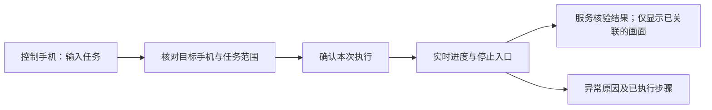
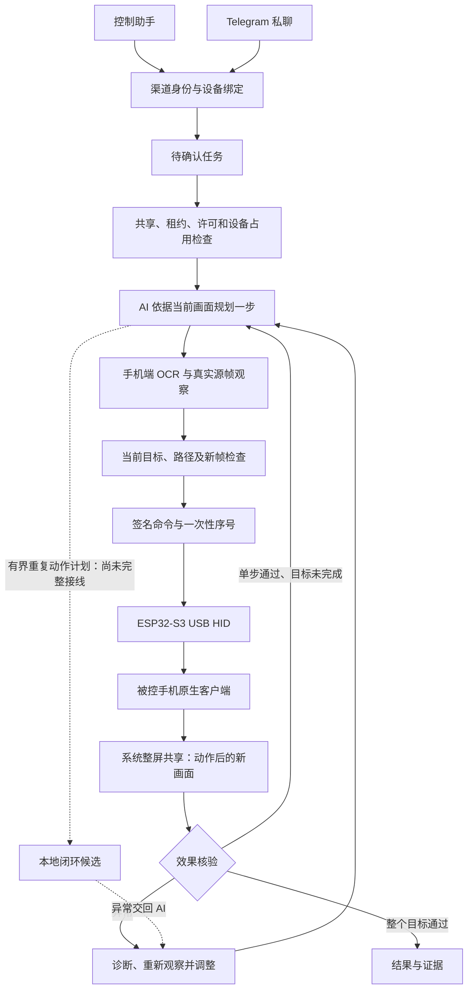

# 手机控制流程与当前验收状态

控制手机可以使用已有绑定，也可按[安装与使用指南](android-getting-started.md)完成配对。控制端录入任务、核对范围并确认执行；确认界面不声称已生成具体操作步骤。连接、整屏共享、操作许可与结果核验分别展示，见[界面说明](android-ui.md)。

## 执行链路

同一任务关联来源、设备、共享会话、命令回执及动作后画面。ACK、单步通过、整个任务完成分别记录。掉线、STOP、过期或结果不明时不重放输入。

## 历史链路改动

- 无效滑动几何触发有界重观测与重规划，不剪裁坐标或放宽路径检查。
- 本地请求匹配客户端实际帧协议，就绪保留手机原始标志并达到该协议的帧数与稳定时长。
- 静态画面采用有时限的源帧采样恢复，缓存 JPEG 不计新源帧。
- 内置模型使用真实 SHA-256，加载后登记元数据并预热，画面推理仍独立绑定新帧。
- 通用浮窗显式持有 WindowManager，提供二维拖动、安全区、位置恢复与可访问操作；小尺寸视觉条与触摸区域分离。
- 控制连接状态不再冒充板端 HID 授权状态。

## 验收边界

代码、测试、云构建、安装和真实手机效果分别记录。已有真实绑定恢复与单步回桌面证据；完整控制助手任务、Telegram 端到端任务、剩余会员日期和完整本地重复动作闭环仍待验收，不因补丁或构建成功宣称完成。

## 后续验收版

兼容模型改用同源 FP32，云端模型清单与 APK 绑定相同 SHA-256；实际 Dart 运行库的加载、预热及输出解析已验证，Android 真机仍单独验收。模型失败只输出固定阶段和错误类别，不泄露路径或原始异常。

控制端重启恢复连接后，只读查询当前入口的最近任务；不重新创建任务或自动确认。目标、绑定、授权、前后台和请求代际发生变化时丢弃晚到结果。入口精简重复说明，保留输入、任务确认、进度、画面和停止路径。
